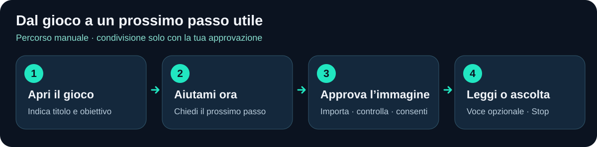

<p align="center">
  
</p>

# Il prossimo passo, più chiaro.

**Decky Pilot è un assistente di gioco per Decky: chiedi un prossimo passo utile, condividi un'immagine di gioco che approvi e, se vuoi, ascolta la risposta.** Scegli il servizio AI e mantieni il controllo di ciò che invii.

[English](README.md) · [Galleria UI](docs/UI_GALLERY.md) · [MVP PR #1](https://github.com/realfulvio/decky-pilot/pull/1) · [Galleria PR #2](https://github.com/realfulvio/decky-pilot/pull/2)


*Concept generato con AI: non è una foto del dispositivo, una schermata dell'applicazione o un test sulla Steam Deck. La copertina riporta lo stesso messaggio del titolo e indica che la verifica hardware è differita.*

> **MVP in revisione.** `main` contiene soltanto questa presentazione. Il codice dell'applicazione resta nelle PR esistenti. Test offline e verifiche del pacchetto Linux controllano l'implementazione; installazione e comportamento su una Steam Deck reale restano **NON ESEGUITI**. Cattura diretta e assistenza visiva automatica sono attualmente indisponibili.

## Come funziona



1. **Apri il gioco.** Indica titolo e ciò che stai cercando di fare. Il contesto manuale supporta anche giochi non Steam.
2. **Premi Aiutami ora.** Chiedi un prossimo passo concreto oppure scrivi una domanda libera.
3. **Condividi soltanto lo screenshot che approvi.** Con immagini abilitate, importa manualmente un PNG/JPEG del gioco, controlla l'anteprima ripulita e il destinatario, poi approva quell'immagine e invia. Questa build non offre una cattura funzionante dal dispositivo con un solo pulsante.
4. **Ricevi un suggerimento, con voce opzionale.** Leggi la risposta completa, ascolta o interrompi la riproduzione. La voce richiede un motore locale già presente oppure consenso separato per Speech online; il percorso audio sulla Deck è da verificare.

Il diagramma illustra il percorso manuale implementato: non è uno screenshot. Senza immagine, l'assistenza usa il contesto fornito. Le immagini non ricostruiscono inventario, missioni o progressi nascosti; i prompt distinguono osservazioni e ipotesi.

## L'interfaccia

**Screenshot reali del browser della React App finale, con componenti HTML sostitutivi dichiarati e dati sintetici.** Non sono mockup né catture su Steam Deck. Non dimostrano richieste AI live, credenziali reali o riproduzione audio. In produzione si usano componenti Decky; il controller richiede verifica sul dispositivo. Le schermate mostrano la lingua inglese predefinita; l'interfaccia dispone anche della traduzione italiana completa.

### Gioca: un'azione chiara

Gioco attivo, una domanda e l'ultima risposta.


### Benvenuto e configurazione

Breve benvenuto, poi gioco, servizio e condivisione.


### Revisione immagine prima dell'analisi

Controlla l'immagine ripulita e il destinatario prima di condividere. L'immagine di test è dichiarata sintetica.


### Suggerimenti e controlli voce

Il testo completo resta disponibile, con Listen e Stop. L'anteprima non riproduce voce.


### Impostazioni e lingue

Inglese predefinito, italiano completo; lingue di interfaccia e assistente indipendenti.


### Impostazioni voce

Voce locale già presente o Speech online autorizzato separatamente, con fallback testuale.


[Tutte le dieci viste, configurazione guidata e annullamento →](docs/UI_GALLERY.md)

## Funzionalità disponibili

| Funzionalità | Riscontri e limiti attuali |
|---|---|
| Aiuto testuale e domande libere | Implementati con adapter nativi OpenAI Responses, Claude Messages, Gemini generateContent e Ollama chat; test offline dei protocolli. Accesso agli account live non verificato. |
| Analisi visiva manuale | Validazione, rimozione metadati, anteprima e approvazione del destinatario per ogni immagine. Modelli cloud nel catalogo documentato; Ollama verifica le capacità. |
| Configurazione e lingue | Componenti Decky reali, tre passaggi, cataloghi inglese/italiano e lingue indipendenti. La lingua dell'assistente governa anche la voce. |
| Risposte complete, annullamento e cronologia | Isolamento sessioni, rifiuto risultati obsoleti, popup di sei secondi e cronologia locale opzionale. Visibilità QAM da verificare sulla Deck. |
| Voce opzionale e Stop | espeak-ng già presente o OpenAI Speech con consenso separato; fallback testuale e pulizia testati. Nessuna installazione automatica del motore. Audio/IPC sul dispositivo non verificati. |
| Screenshot diretti dal gioco | **Disabilitati.** Il comando Gamescope esaminato non individua atomicamente il gioco autorizzato, quindi non esclude affidabilmente superfici sensibili. |
| Aiuto visivo automatico | Consenso di sessione, pausa, intervallo e limiti implementati offline; attivazione indisponibile finché non è stabilita una cattura sicura. |
| Compatibilità Steam Deck | **NON ESEGUITI:** ABI, installazione, focus controller, selettore, rilevamento, popup QAM, audio, prestazioni e sleep/resume. Nessuna pubblicazione store o compatibilità certificata. |

## Il tuo servizio, le tue scelte di condivisione

Scegli OpenAI, Claude, Gemini oppure Ollama e un modello disponibile per te. Contesto chat, immagini, endpoint Ollama e voce online hanno permessi distinti. Nessuna sostituzione implicita di modello/provider. Le API possono avere costi; disponibilità e condizioni dipendono dall'account. La configurazione non avvia automaticamente un test connessione a pagamento.

Nessuna telemetria o server centrale Decky Pilot. Le chiavi restano in file backend privati e non tornano al frontend; software locale con gli stessi accessi può leggerle. La cronologia resta in memoria salvo scelta esplicita. Puoi cancellare conversazione o dati locali del plugin. Cancellare localmente non ritira dati già inviati al provider. Condividi soltanto immagini di gioco che intendi inviare; non importare schermate di account o credenziali.

## Revisione o anteprima offline

L'applicazione è su `codex/deckpilot-mvp`, **non su `main`**. Per un checkout sviluppatore separato:

```sh
git clone --branch codex/deckpilot-mvp https://github.com/realfulvio/decky-pilot.git
cd decky-pilot
corepack pnpm install --frozen-lockfile
corepack pnpm preview
```

Usa Node 24.20.0 e pnpm 10.28.2. L'anteprima browser è su `http://127.0.0.1:5173`, con risposte sintetiche e senza account AI. Test Python, build, vendoring/pacchetto e criteri hardware sono sul branch MVP:

- [Sviluppo e verifiche](https://github.com/realfulvio/decky-pilot/blob/codex/deckpilot-mvp/docs/DEVELOPMENT.md)
- [Risultati dei test e CI Linux](https://github.com/realfulvio/decky-pilot/blob/codex/deckpilot-mvp/docs/TEST_PLAN.md)
- [Riscontri sulla sicurezza della cattura](https://github.com/realfulvio/decky-pilot/blob/codex/deckpilot-mvp/docs/CAPTURE_VERIFICATION.md)
- [Checklist hardware](https://github.com/realfulvio/decky-pilot/blob/codex/deckpilot-mvp/docs/HARDWARE_VALIDATION.md)
- [Privacy](https://github.com/realfulvio/decky-pilot/blob/codex/deckpilot-mvp/docs/PRIVACY.md) e [sicurezza](https://github.com/realfulvio/decky-pilot/blob/codex/deckpilot-mvp/docs/SECURITY.md)

ZIP di revisione e file SHA256 sono artefatti CI, non una release né una raccomandazione d'installazione. Nessuna PR è stata unita e nulla è stato pubblicato nello store Decky.

[Origine immagini e riproduzione](docs/PRESENTATION_ASSETS.md) · [Verifica pubblicazione](docs/PUBLICATION_REVIEW.md) · [Licenza applicazione BSD-3-Clause](https://github.com/realfulvio/decky-pilot/blob/codex/deckpilot-mvp/LICENSE)
