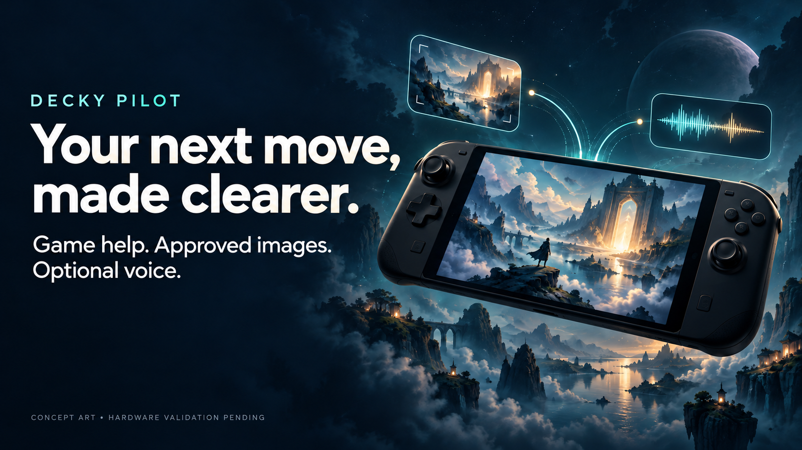
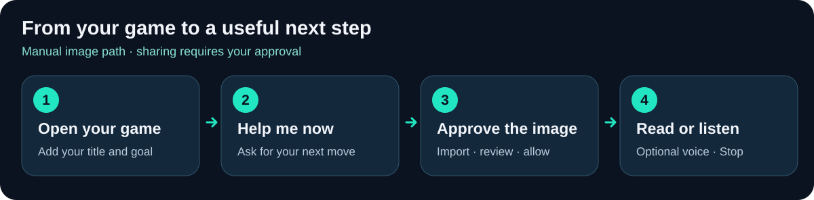
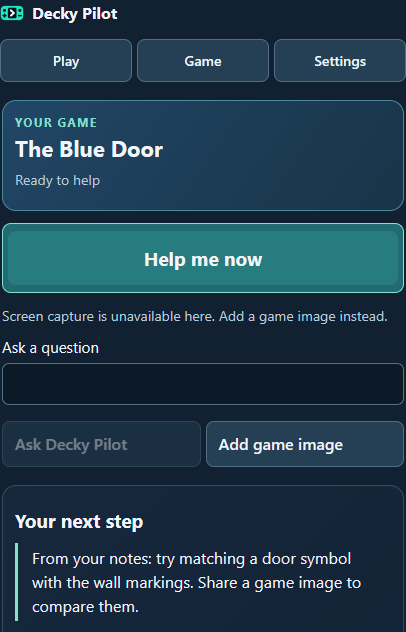
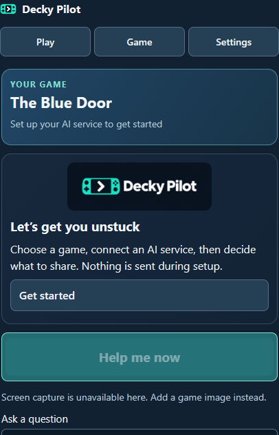
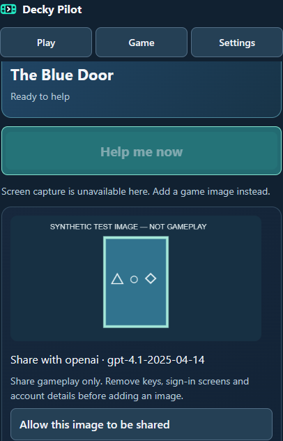
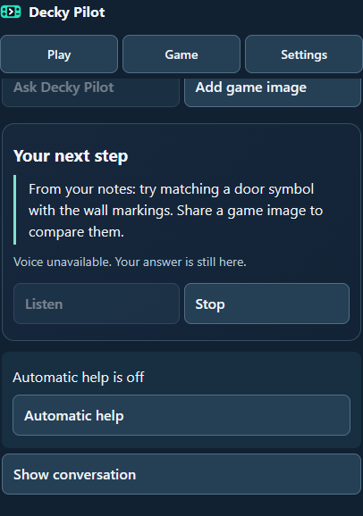
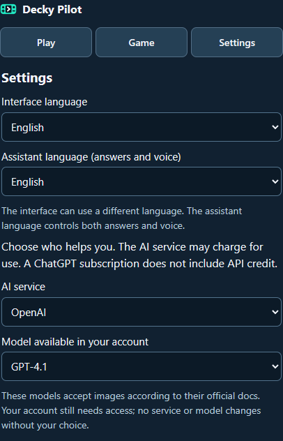
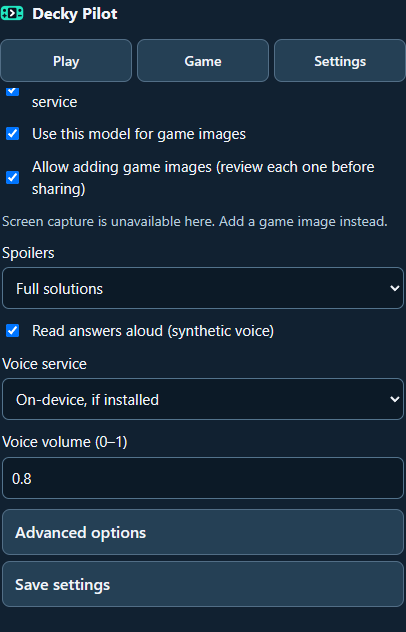

<p align="center">
  
</p>

# Your next move, made clearer.

**Decky Pilot is a game companion for Decky: ask for a useful next step, share a game image you approve, and listen to the answer if you want.** Choose your AI service and keep control of what you send.

[Italiano](README.it.md) · [UI gallery](docs/UI_GALLERY.md) · [MVP PR #1](https://github.com/realfulvio/decky-pilot/pull/1) · [Gallery PR #2](https://github.com/realfulvio/decky-pilot/pull/2)



*AI-generated concept artwork, not a device photograph, application screenshot or Steam Deck test.*

> **MVP in review.** `main` contains this presentation only. Application code remains in the existing PRs. Offline tests and Linux package checks verify the implementation; installation and behavior on a real Steam Deck remain **NOT RUN**. Direct game capture and automatic visual help are currently unavailable.

## How it works



1. **Open your game.** Add its title and what you are trying to do. Manual context also supports non-Steam games.
2. **Press Help me now.** Ask for a concrete next step, or write your own question.
3. **Share only the screenshot you approve.** With images enabled, manually import a gameplay PNG/JPEG, review the cleaned preview and named recipient, then approve that image and send. There is no working one-button device capture in this build.
4. **Get a suggestion, with optional voice.** Read the full answer, listen or stop playback. Voice needs an existing local engine or separate online Speech permission; actual Deck audio routing is unverified.

The workflow diagram is an illustration of the implemented manual-image path, not a screenshot. Without an image, help uses the context you supplied. Images cannot establish hidden inventory, quests or progress; prompts distinguish observations from guesses.

## The interface

**Actual browser screenshots of the final React App, using labelled HTML stand-ins and synthetic data.** These are not mockups or Steam Deck captures. No live AI request, real credential or audio playback is demonstrated. Production injects Decky controls; controller behavior needs device validation.

### Play: one clear action

Active game, a question and your latest answer.



### Welcome and onboarding

A short welcome, followed by game, service and sharing choices.



### Image review before analysis

Check the cleaned image and named destination before sharing. The fixture is visibly labelled synthetic.



### Suggestions and voice controls

Full text stays available, with Listen and Stop. The preview does not play speech.



### Settings and languages

English by default, complete Italian; independent interface and assistant languages.



### Voice settings

Existing local voice or separately authorized online Speech, with text fallback.



[See all ten views, including guided setup and cancellation →](docs/UI_GALLERY.md)

## What is available

| Capability | Current evidence and limits |
|---|---|
| Text help and free questions | Implemented with native OpenAI Responses, Claude Messages, Gemini generateContent and Ollama chat adapters; offline protocol tests. Live account access is not verified. |
| Manual visual analysis | Image validation, metadata removal, preview and per-image recipient approval are implemented. Cloud models must be in the documented image-input catalog; Ollama checks model capabilities. |
| Guided setup and languages | Real Decky components, three-step setup, English/Italian catalogs and independent interface/assistant languages. Assistant language also governs speech. |
| Full answers, cancellation and history | Implemented with session isolation, stale-result rejection, a six-second popup and optional local history. Actual QAM visibility needs a Deck. |
| Optional voice and Stop | Existing espeak-ng or separately permitted OpenAI Speech; text fallback and cleanup are tested. No engine is installed automatically. Device routing/IPC is unverified. |
| Direct game screenshots | **Disabled.** The inspected Gamescope command does not atomically target the authorized game, so sensitive surfaces cannot be reliably excluded. |
| Automatic visual help | Session consent, pause, cooldown and attempt limits are implemented offline; activation remains unavailable while safe capture is unestablished. |
| Steam Deck readiness | **NOT RUN:** ABI, installation, controller focus, picker, detection, QAM popup, audio and performance/sleep-resume. No store publication or certified device support. |

## Your service, your sharing choices

Choose OpenAI, Claude, Gemini or Ollama and a model available to you. Chat context, images, an Ollama endpoint and online voice have separate permissions. No silent model/provider substitution. Provider/API usage can incur costs; availability and terms depend on your account. Setup does not automatically send a paid connection test.

No telemetry or Decky Pilot central server. API keys stay in private backend files and are never returned to the frontend; local software with the same access can read them. History is in memory unless you opt in. You can delete conversation or local plugin data. Deleting locally cannot retract data already sent to a provider. Share only gameplay images you intend to send; do not import account or credential screens.

## Review or try the offline preview

The application is on `codex/deckpilot-mvp`, **not on `main`**. For a separate developer checkout:

```sh
git clone --branch codex/deckpilot-mvp https://github.com/realfulvio/decky-pilot.git
cd decky-pilot
corepack pnpm install --frozen-lockfile
corepack pnpm preview
```

Use Node 24.20.0 and pnpm 10.28.2. The browser harness runs at `http://127.0.0.1:5173` with synthetic replies and no AI account needed. Python tests, build, vendor/package instructions and hardware acceptance criteria live on the MVP branch:

- [Development and verification](https://github.com/realfulvio/decky-pilot/blob/codex/deckpilot-mvp/docs/DEVELOPMENT.md)
- [Test evidence and Linux CI](https://github.com/realfulvio/decky-pilot/blob/codex/deckpilot-mvp/docs/TEST_PLAN.md)
- [Capture safety findings](https://github.com/realfulvio/decky-pilot/blob/codex/deckpilot-mvp/docs/CAPTURE_VERIFICATION.md)
- [Hardware checklist](https://github.com/realfulvio/decky-pilot/blob/codex/deckpilot-mvp/docs/HARDWARE_VALIDATION.md)
- [Privacy](https://github.com/realfulvio/decky-pilot/blob/codex/deckpilot-mvp/docs/PRIVACY.md) and [security](https://github.com/realfulvio/decky-pilot/blob/codex/deckpilot-mvp/docs/SECURITY.md)

Review ZIPs and SHA256 files are CI artifacts, not a release or installation recommendation. No PR has been merged and nothing has been published to the Decky store.

[Image provenance and reproduction](docs/PRESENTATION_ASSETS.md) · [Publication review](docs/PUBLICATION_REVIEW.md) · [BSD-3-Clause application license](https://github.com/realfulvio/decky-pilot/blob/codex/deckpilot-mvp/LICENSE)
