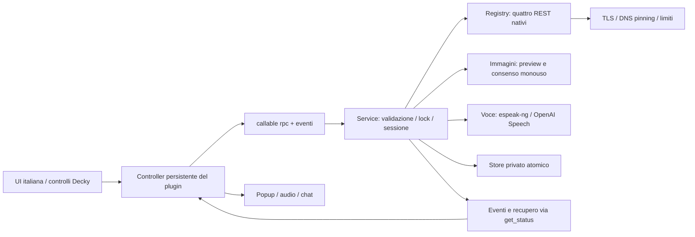

# Architettura

Il plugin usa React/TypeScript dal template ufficiale Decky con backend Python indipendente dal Loader. `main.py` collega lifecycle e una sola porta Decky `rpc(method,payload)`; `Service.rpc` implementa l'allowlist dei metodi nominati nella specifica. Envelope `{ok:true,data}` / `{ok:false,error}`: solo messaggi italiani controllati dal backend. Un adapter non può ricevere provider/consenso dal payload chat.

`backend/providers.py`: OpenAI/Gemini/Claude/Ollama hanno protocolli distinti e normalizzano answer/usage; nessun adapter fittizio. `backend/transport.py`: HTTP stdlib in worker, IP validato e fissato nella connessione, TLS hostname originale, nessun redirect/proxy/SDK/retry. Cancella connessioni best effort; un worker bloccato in resolver OS può finire dopo l'annullamento ma non inizia la chiamata se già revocata. Deadline limita l'attesa UI, senza promessa di cancellazione sul provider.

`backend/service.py`: lock per admission, idempotenza per ultimi 100 request ID/sessione, una generazione globale. Nuova sessione al cambio gioco o su richiesta; revisione solo per modifica reale del contesto. Ogni risultato/evento porta request/session/revision; cambio contesto cancella task e handle. Il frontend scarta eventi precedenti, conserva le risposte complete e recupera stato ogni 5 s. Dopo reload non rigenera TTS per cronologia già completata. Listener/presenter/scheduler vivono fuori dal mount del pannello.

Scheduler backend ogni 5 s: intervallo monotono minimo 90 s, prenotato prima della chiamata; nuovo contesto con note entro 300 s, source confermata, nessun task/voce attiva, cooldown errori e budget. Un gap >15 s è trattato come resume, con attesa di un intervallo intero. Un heartbeat identico non rinnova freschezza. Tre errori sospendono, dedup normalizza testo, 20 tentativi richiedono riattivazione esplicita. Le richieste manuali sono indipendenti dal cooldown automatico e rispettano concorrenza/Retry-After.

Il prompt separa policy backend, note/immagini non affidabili e domanda. Ultimi 12 messaggi entro 8.000 caratteri, input 4.000 e note totali 8.000. Non sono abilitati tool, ricerca web, shell, STT, OCR o lettura memoria. Lo spoiler è una policy di prompt, non garanzia semantica assoluta.

Immagini: `prepare_image` accetta bytes da azione esplicita nel harness; produzione usa picker Decky + `prepare_import_image(filename,sessionId)` ristretto alla radice runtime. Pillow verifica MIME, dimensioni, formato/animazione e decodifica, ridimensiona e ricodifica senza metadati. La preview è la copia inviata. Consenso legato a provider/modello/endpoint/sessione, scadenza 300 s, monouso. Solo una immagine pendente; nessuna immagine in cronologia.

Voce: `start_tts` può sintetizzare solo risposta già presente nella sessione/revisione corrente; testo massimo 1.000 caratteri. Task unico, WAV base64 massimo 8 MB, nessun listener HTTP. `tts_state=ready` conserva bytes solo per recupero evento; fine riproduzione/Stop/changement/unload elimina lo stato e revoca object URL. Locale senza motore o remoto senza consenso → stato esplicito e fallback testuale. Nessuna coda illimitata: un nuovo avvio sostituisce il precedente dopo stop.

Store: schema versione 1; migrazione baseline 0 senza perdita campi validi, schema futuro/corrotto rifiutato. Chiavi separate, configurazione pubblica solo booleana. File atomici e permessi POSIX; non cifrati. Cronologia in memoria di sessione; persistenza opt-in con retention 7 giorni, 100 messaggi/gioco, 20 giochi/1,8 MB globali. Scadenza controllata al load e sul timer 5 s. Gli originali importati dall'utente non sono temporanei del plugin e rimangono sotto controllo manuale.

`contracts/rpc-v1.schema.json` e fixture sintetiche definiscono request/result/context/error. Validazione runtime backend è esplicita; JSON Schema e guard TypeScript testano gli stessi dati. Gli handler impongono allowlist/range, senza affidarsi ai soli tipi frontend.
