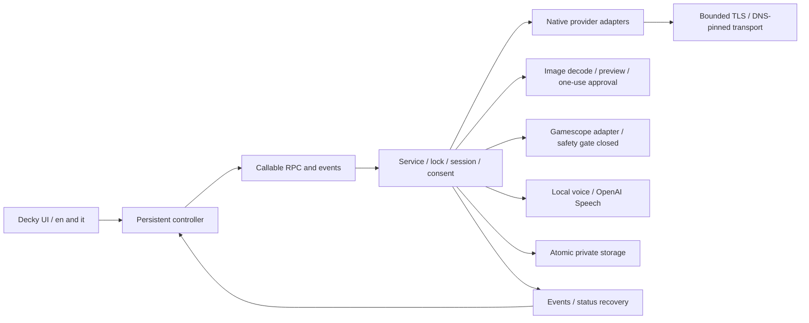

# Architecture

The React/TypeScript frontend uses the official Decky controls through `DeckyControls`. The labelled offline harness injects DOM controls into the same App. `main.py` connects Loader lifecycle to an independently importable Python domain. One Decky callable, `rpc(method,payload)`, exposes a backend allowlist with validated fields/ranges and `{ok,data}` or `{ok:false,error}` envelopes.

App has Play, Game and Settings plus a three-step onboarding flow. Play contains game title, primary action, question, image review, latest answer, voice and automatic status. Keys/consents/provider/languages/limits live in Settings; diagnostics are not rendered in the normal UI. Optional AppID is under Game's Advanced options. Shared `locales/en.json` and `it.json` supply UI/errors/prompts, checked for key and interpolation parity. Independent language defaults migrate missing schema-1 fields without discarding valid settings/secrets.

`providers.py` implements four distinct REST protocols, not a generic simulated adapter. `transport.py` uses bounded stdlib HTTP in a worker, validates and pins DNS addresses, verifies TLS against the original host and refuses redirects/proxies. Cancellation is best effort: a blocked OS resolver may finish later, and remote work already sent cannot be recalled. No automatic paid retries or provider fallback.

Service serializes admission under a lock, permits one global generation, and remembers the last 100 request IDs/session for idempotence. Changing game or explicitly starting fresh creates a session; meaningful context edits increment revision. Results/events carry request/session/revision. Context/settings/key changes cancel tasks, clear image approval and stop voice. Frontend listeners and presenters survive panel mounts; serialized refreshes recover status every five seconds and ignore stale results. Completed history does not repay TTS after reload.

Automatic assistance requires ephemeral current-session consent, separate from saved settings. Minimum monotonic interval is 90 seconds, reserved before work. A new confirmed context with meaningful notes must be at most 300 seconds old. Active voice/requests, duplicate content/images, unknown game and capture guard block work. Scheduler gaps over 15 seconds postpone attempts for a full interval after resume. Three errors pause assistance; twenty attempts need explicit reauthorization. No unchanged heartbeat renews freshness. The visual path is unavailable in production until the capture safety gate is satisfied.

`capture.py` implements fixed-argument Gamescope CLI invocation, local compositor and focused-app checks, a private unique output folder, bounded asynchronous completion and cleanup. These checks are insufficient for atomic game targeting, so `CAPTURE_SAFETY_VALIDATED=False`. See [the source-backed findings](CAPTURE_VERIFICATION.md). RPC requires explicit gameplay confirmation; returning a preview never approves sending it. Settings navigation blocks/cancels pending acquisition. Offline test doubles exercise this lifecycle without enabling production capture.

Images are explicitly imported through the Decky picker from a dedicated runtime root, or uploaded as bytes in the harness. Pillow verifies static PNG/JPEG, MIME, 5 MiB/20 MP limits, decodes, transposes EXIF, resizes and re-encodes without metadata. The preview is the actual send copy. Approval is bound to session/provider/model/endpoint, expires after 300 seconds and is consumed once. Images never enter history. Original import files remain user-owned.

Prompts separate trusted backend policy from untrusted JSON context, question, history and image contents. Limits: 12 recent messages/8,000 characters, 4,000-character question and 8,000 total context characters. Prompts require selected response language and distinguish observations from hypotheses about hidden state. No shell, tools, browsing, memory reads, STT, OCR or retrieval are enabled. Spoiler constraints remain model instructions, not a semantic guarantee.

TTS reads only a completed answer from the current revision/session, bounded to 1,000 characters and 8 MB WAV. Local espeak-ng receives fixed argv and stdin; OpenAI Speech needs its own key/consent. `ttsLanguage` selects local voice or remote pronunciation instructions, without translating input. Unsupported remote instruction models fail explicitly. Audio/object URLs/task state are cleared on completion, Stop, revocation and unload; missing audio leaves text available. There is no additional HTTP audio server.

Storage is schema 1, with validated migration from baseline 0; corrupt/future files fail without reset. Atomic writes/fsync/replace and POSIX permissions protect separate plaintext secrets. Persistent history is opt-in: seven days, 100 messages/game, 20 games/1.8 MB overall, pruned at load and every scheduler tick. `contracts/rpc-v1.schema.json`, actual backend results and shared fixtures are checked in Python and TypeScript.
