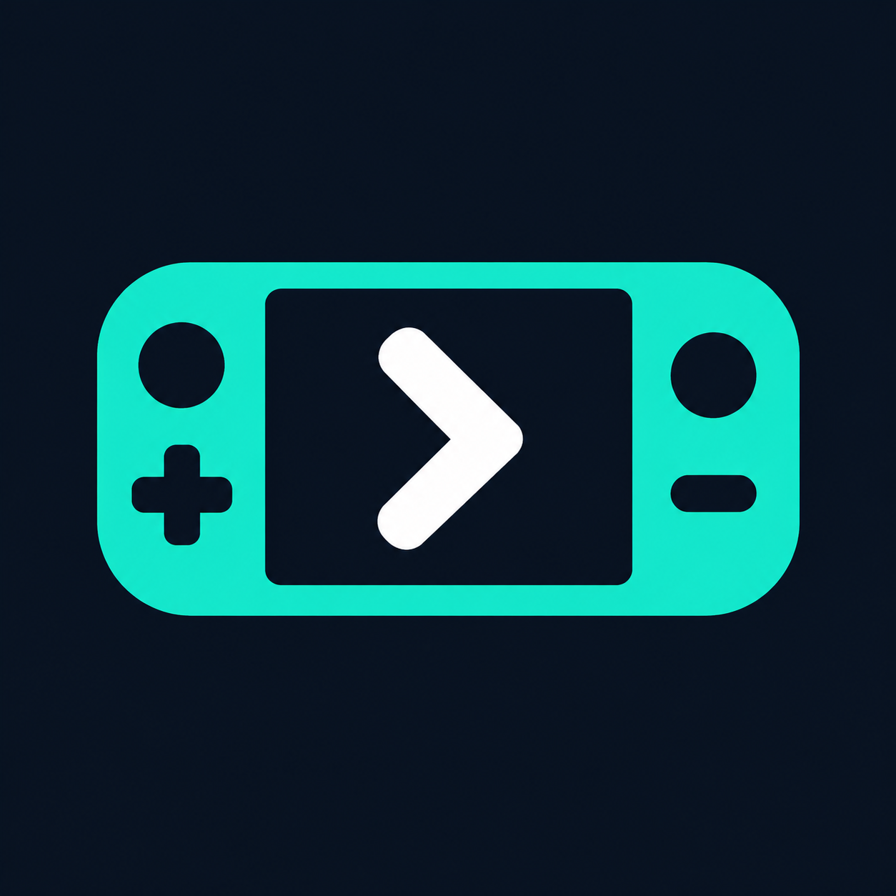

# Decky Pilot — brand assets

The public product name is **Decky Pilot**, as requested by the owner on 12 October 2026. The GitHub repository and existing technical identifiers may remain `deckpilot`; changing the display name must not discard saved settings, keys or history.

## Assets




- Horizontal logo: `assets/brand/decky-pilot-logo-dark.png`.
- Square symbol: `assets/brand/decky-pilot-icon-dark.png`.
- PNG raster assets generated with built-in ImageGen; these selected versions have an opaque dark background, not transparency.
- Identity: handheld gaming device, forward navigation chevron, mint/teal, white and navy.
- Intended colors: teal `#21E6C1`, white `#FFFFFF`, navy `#0B1320`. Generated pixels may vary slightly from these target values.

These are brand assets for integration, not proof that the current app has already been renamed or its icon replaced. Actual small-size rendering remains to be inspected during integration. A simplified vector implementation can follow for a crisp menu icon; do not call the PNG an SVG.

## Integration task for the implementation branch

Use **Decky Pilot** in the visible plugin name, headings, onboarding and English public documentation. Integrate the logo into the README and onboarding; use the symbol alone for menu/icon surfaces. Provide accessible alt text and maintain legible sizing. Preserve existing internal identifiers/storage paths unless a tested migration is necessary. Do not rename the repository, break the remote, discard keys or rename the working branch as a side effect. Keep existing Italian strings as translations while English becomes the default UI.

The assets are added on `docs/ui-gallery`, alongside PR #2, so they do not modify the checkout being edited by the other Codex session. Integration into the application should be coordinated there and on the MVP branch.

## Generation prompts

Tool: built-in ImageGen, not a CLI/API script.

### Horizontal logo

```text
Design a polished original production logo for the gaming AI companion app 'Decky Pilot'. Use a perfectly uniform opaque dark navy background #0B1320, no transparency. Horizontal logo lockup: on left a simple bold mint-teal handheld console silhouette, with a white forward navigation chevron centered in the dark screen, minimal circular controls and a compact plus sign; on right exact text 'Decky Pilot' in pure white clean bold rounded geometric sans serif. Text must be razor crisp solid continuous shapes, professionally typeset with excellent kerning and correct spelling, absolutely no distressed/grunge/broken lettering. Symbol feels like a helpful gaming navigator, approachable, legible at small size. Flat vector-style fills, clean sharp smooth edges. Teal #21E6C1, white #FFFFFF, navy #0B1320 only. Balanced wide composition, ample clean margins around centered logo. No gradients, texture, glow, shadows, noise, 3D, mockup, extra text or watermark. Original mark, do not imitate any existing Steam/Valve/Decky corporate logo. Finished high-quality brand logo, not a concept sheet.
```

### Square icon

The horizontal logo was supplied as an identity reference.

```text
Create a matching square app icon for Decky Pilot using the handheld-and-chevron symbol in this logo as identity reference. Only the symbol, absolutely NO text or lettering. Square canvas with opaque dark navy #0B1320 background, centered bold teal handheld silhouette with a white forward chevron inside a dark navy screen. Simplify controls to a minimal circle and plus on left, circle and short rounded dash on right, bold enough to read at 24 pixels. Flat clean crisp continuous shapes, smooth precise corners, no texture, gradients, shadows, glow or distressed edges. Generous equal padding, symbol fills about 75 percent canvas width. Preserve teal/white/navy identity from reference. Finished minimal recognizable menu icon.
```
