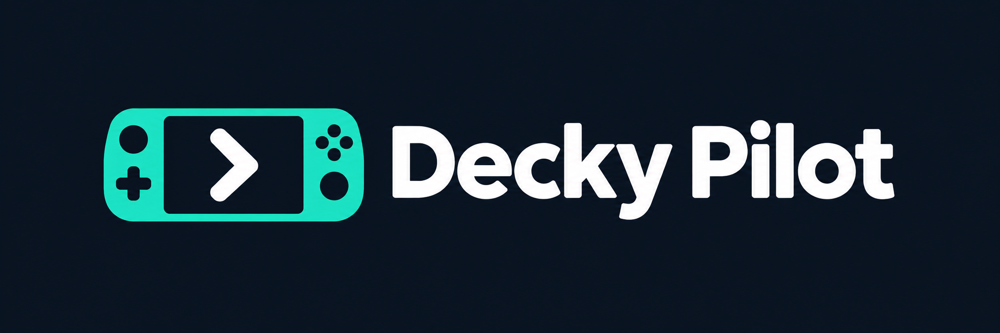

# Decky Pilot



A Decky game assistant that helps you find your next step. English is the default; the complete Italian interface is available in Settings. [Leggi in italiano](../README.it.md).

Decky Pilot is an MVP under review in [PR #1](https://github.com/realfulvio/decky-pilot/pull/1). The [UI gallery in PR #2](https://github.com/realfulvio/decky-pilot/pull/2) uses the same React screens in an explicitly labelled offline preview. A first Steam Deck run on 17 October 2026 verified installation, storage and the backend; the on-screen panel, controller and audio are still pending ([device evidence](HARDWARE_VALIDATION.md)).

## Get help

1. Follow **Get started**: choose your game, connect an AI service, and choose what to share. Setup sends no AI requests.
2. In **Play**, use **Help me now**, or ask your own question. The latest answer and voice controls stay together.
3. For visual help, enable images in Settings, choose a PNG or JPEG containing gameplay only, review the cleaned image and recipient, then approve that image before sending it. On Deck, copy the image into the dedicated import folder shown under Advanced options, then choose it with the Decky picker.

ChatGPT plan access uses the official local/open-source OAuth flow; advanced OpenAI API access uses a separate developer key and billing. Claude, Gemini and Grok use their native APIs; Ollama uses its local chat API and checks model capabilities. Load the selected connection's catalog for actual IDs/names, then select a model. Image capability is separately gated. No model/provider is silently substituted, and consumer plans do not authorize developer API billing. Sign-in retrieves metadata only; game/image sharing remains separate. See [provider verification](PROVIDER_VERIFICATION.md).

An image can suggest an area or objective. It cannot establish hidden progress, inventory or quests. Prompts require visible observations to be separated from guesses, with one concrete next step or a question when context is missing. Model accuracy and spoiler compliance are not guaranteed.

## Screen capture and automatic help

**Direct Gaming Mode capture is unavailable in this build.** We inspected Valve's actual Gamescope screenshot command and implemented a bounded adapter, but acquisition stays disabled: the upstream command is not atomically bound to a particular game window and can capture a different surface during a focus transition. This fails the requirement to avoid keys and account screens. There is no simulated production capture or invented Steam API. See [capture findings and acceptance criteria](CAPTURE_VERIFICATION.md).

Manual image import and analysis are implemented. **Help me now** offers import when images are enabled; otherwise it uses the context you supplied.

The optional automatic visual path is implemented and tested offline, but is unavailable while capture is disabled. It requires separate consent for the current session, shows an active indicator, offers immediate pause, and waits at least 90 seconds between attempts. Only fresh meaningful context permits a new analysis; identical context/images, unknown games, active requests or voice, errors and sleep/resume suppress work. It does not continuously scan the screen or infer that you are stuck. A game change/reload/settings or key change revokes session consent. Twenty attempts require another explicit allowance. No device test is claimed.

## Language and voice

Settings has two independent choices: **Interface language** and **Assistant language (answers and voice)**. Both initially default to English and support English and Italian. The assistant language governs both generated answers and synthesized speech, following the latest product decision. Shared catalogs cover the interface, safe errors and prompts. Existing valid settings and saved keys are preserved when the new defaults are added.

Voice reads the answer as written in the selected assistant language; it does not translate old conversation text. Local voice uses espeak-ng when already installed. Online voice uses OpenAI Speech with a separate key/consent and `gpt-4o-mini-tts`, whose instructions support the assistant language. Voice is synthetic; text remains available if audio fails. Nothing installs espeak-ng automatically.

## Development and verification

Pinned toolchain: Node 24.20.0, Corepack/pnpm 10.28.2, Python 3.11.7 in Linux CI. Windows development uses Python 3.13.15. Production uses Decky API 1.1.3 and Decky UI 4.12.1; React and Decky UI are external in the plugin bundle.

```sh
corepack pnpm install --frozen-lockfile
python -m venv .venv
# Activate the virtual environment for your shell, then:
python -m pip install -r requirements-dev.txt
corepack pnpm verify
python -m ruff check backend main.py scripts tests/backend
python -m pytest -q
python scripts/scan_secrets.py
node scripts/audit.mjs
python scripts/audit_python.py
corepack pnpm exec playwright install chromium
# Linux: set PLAYWRIGHT_CHANNEL=chromium. Windows defaults to installed Edge.
corepack pnpm exec playwright test
python scripts/vendor.py
python scripts/package.py
python scripts/verify_package.py artifacts/deckpilot-0.1.0.zip
# Linux CPython 3.11 only: verify the extracted deliverable in an isolated process
python scripts/verify_package.py artifacts/deckpilot-0.1.0.zip --runtime
```

`corepack pnpm preview` serves the offline harness on `127.0.0.1:5173`. Its sample replies, delay/error buttons and DOM controls are for review; production injects real Decky components. Neither preview nor keyboard tests certify Steam controller behavior. Backend fixtures substitute provider transport and use synthetic data. No real key is needed. With the preview server running, `node scripts/capture_gallery.mjs` saves fifteen English views and fifteen directly captured panels plus source metadata under `artifacts/gallery/`; use `PLAYWRIGHT_CHANNEL=chromium` on Linux. Stop preview before Python tests on Windows to avoid watcher interference with atomic temporary-file operations.

[Test evidence](TEST_PLAN.md), [API sources](API_VERIFICATION.md), [hardware checklist](HARDWARE_VALIDATION.md), [handoff](CODEX_HANDOFF.md).

## Package and future device validation

The generated installable ZIP contains one `DeckPilot/` root, the frontend/backend, both locale catalogs and hash-pinned Linux x86_64 CPython 3.11 Pillow, PyJWT, cryptography, cffi and pycparser wheels with licenses. Auth pins/hashes are in `contracts/auth-wheels.json`. Linux CI verifies extracted RSA signing/verification and Pillow/plugin lifecycle. The source ZIP comes from the committed revision; checksums sit beside both archives. These are review artifacts, not a release.

Before installation, confirm the Decky's Python ABI, SteamOS/glibc, UID and Loader versions using the hardware checklist; Decky Loader 3.2.10 on SteamOS 3.8.28 embeds CPython 3.11, matching the vendored wheels. Use the installed Loader's developer ZIP installation flow. No project script installs on or changes SteamOS. The 17 October 2026 device run installed only this plugin, through the Loader's own ZIP flow; no store publication or release took place. A test client on Decky's websocket preempts the Steam UI's connection, so never resend calls (see HARDWARE_VALIDATION).

## Your data

No telemetry or Decky Pilot central server. Provider, image, Ollama endpoint and online Speech permissions are separate. Keys are plaintext private backend files (POSIX directories 0700/files 0600), never returned by RPC or stored in the browser. Local software with the same access can read them.

History is in memory unless you opt in: at most 100 messages/game, seven days, 20 games and 1.8 MB overall. Delete conversation keeps keys. Delete local data removes plugin settings/keys/history but retains original imported files you supplied. Uninstall may retain Loader settings; delete explicitly first. Local deletion/cancellation does not retract already sent provider data or guarantee a refund.

If capture is unavailable, add a game image manually. If a model does not support images, choose a compatible model and renew consent; remove an attachment explicitly to continue with text. If voice fails, read the full answer or check the separate voice settings. Retry network/rate errors manually. Corrupt storage fails without silently resetting your files; never attach `secrets.json` to a bug report.

[Privacy](PRIVACY.md), [security and audit](SECURITY.md), [architecture](ARCHITECTURE.md), [backlog](BACKLOG.md), [roadmap](ROADMAP.md).

BSD-3-Clause. Steam Deck Homebrew template attribution and dependency terms are in [third-party notices](THIRD_PARTY_NOTICES.md). The original Italian `DECKPILOT_CODEX_SPEC.md` is preserved as the historical baseline; subsequent user requirements recorded in the handoff supersede its default language and product layout.

[Current product decisions](PRODUCT_DECISIONS.md) replace conflicting language/name choices in the historical spec. [Brand sources and small-menu implementation](BRANDING.md).
