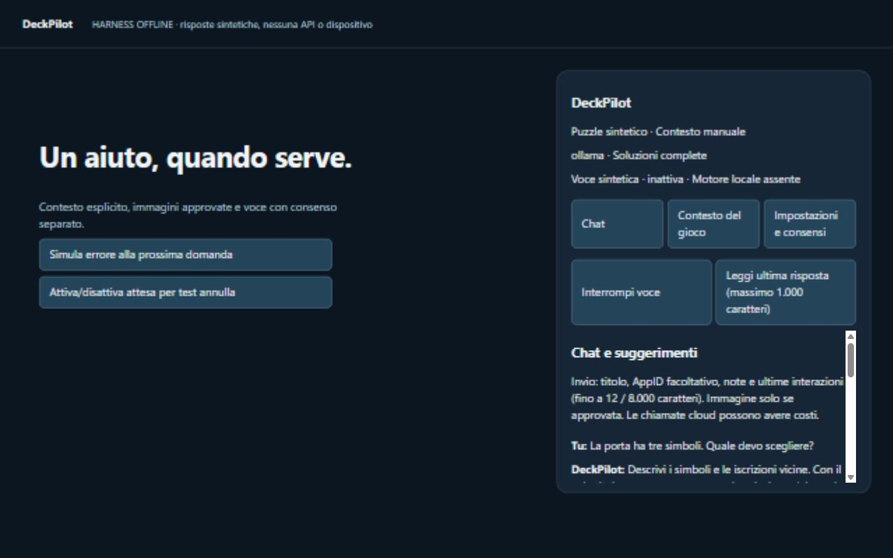
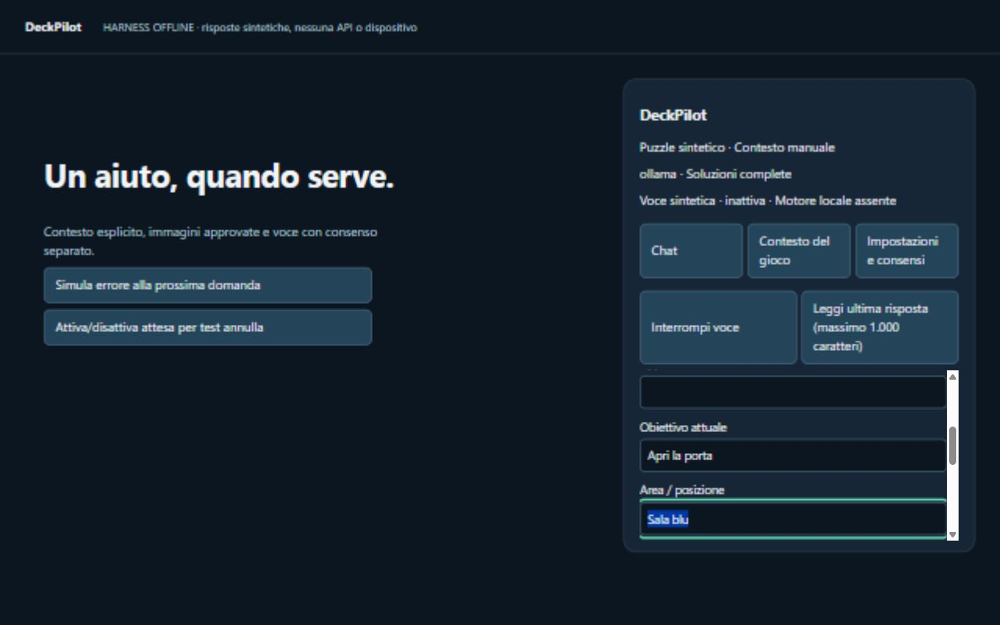
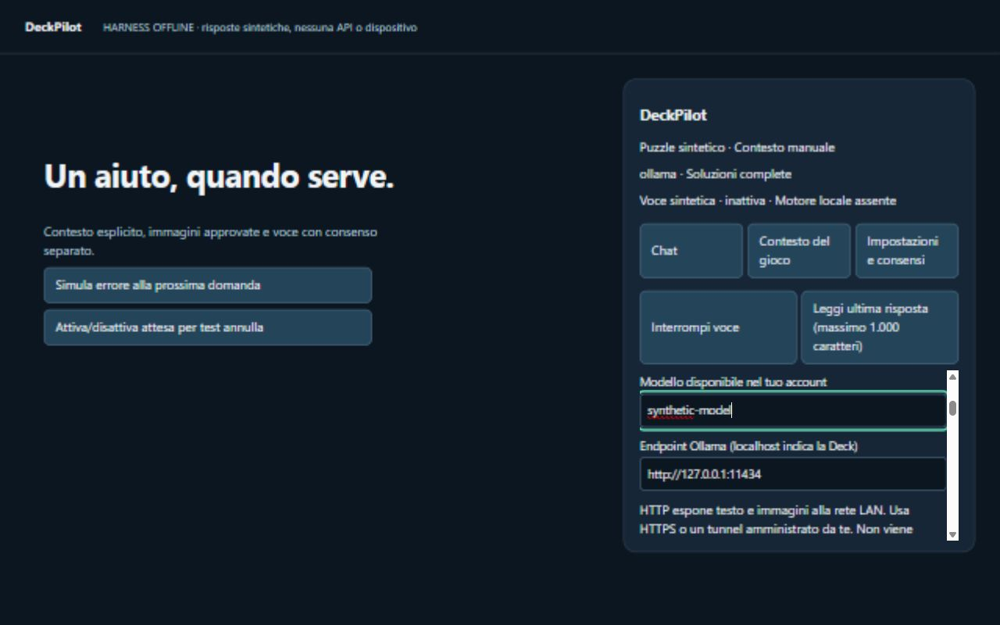
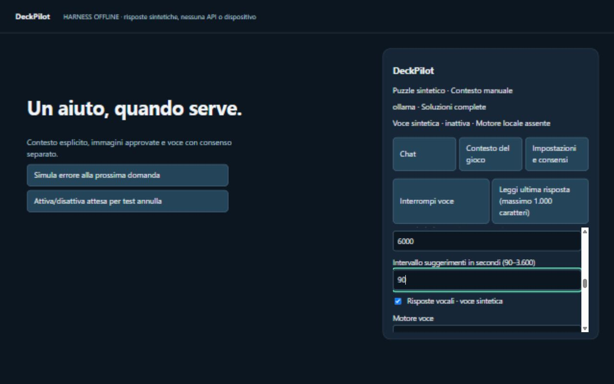
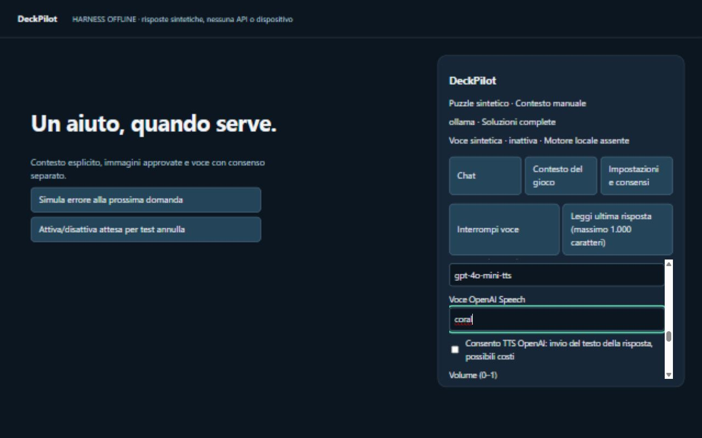
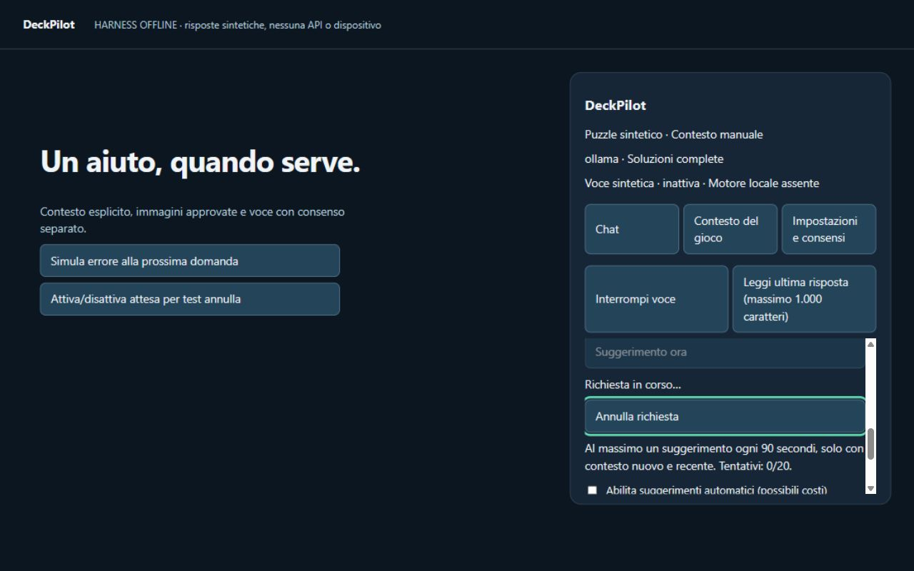
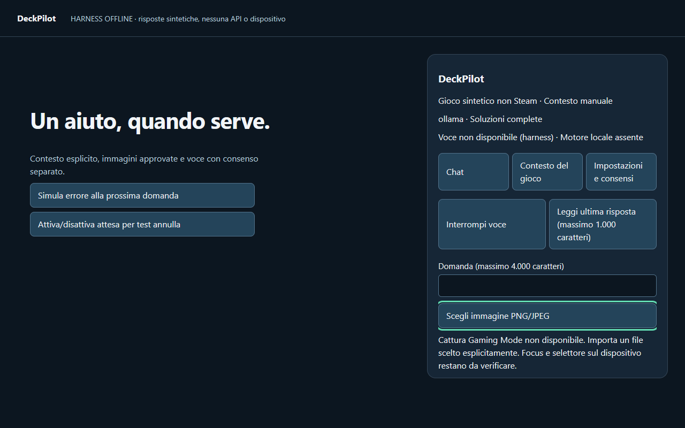
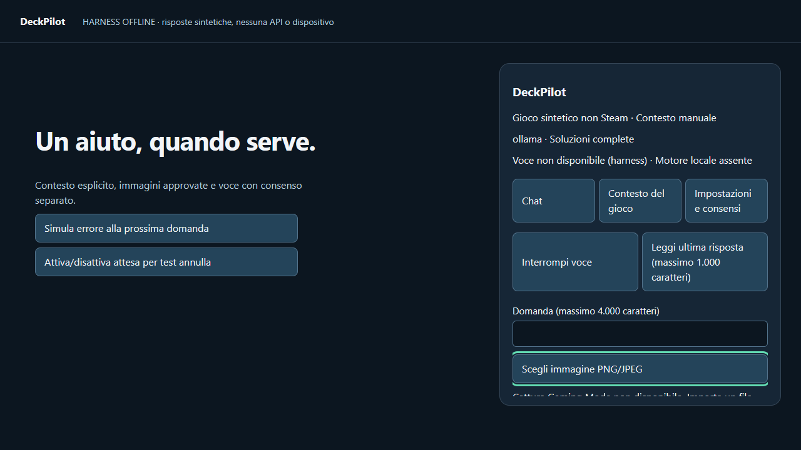

# DeckPilot — galleria dell’interfaccia MVP

Anteprime acquisite il 12 ottobre 2026 dal frontend del commit `74595ec`, in ambiente browser offline. I dati e le risposte sono sintetici; nessuna API key o chiamata AI reale è stata usata.

Queste sono schermate dell’implementazione attuale, non rendering generati. Il pannello usa gli stessi componenti applicativi dell’MVP, con controlli HTML sostitutivi nel harness. Dentro Decky i controlli vengono forniti da `@decky/ui`: font, focus, spaziature, popup e rendering in gioco devono ancora essere verificati sulla Steam Deck.

La parte sinistra con i pulsanti di simulazione appartiene soltanto all’ambiente di prova. Il plugin è il pannello a destra. Le catture sono a 1280×800; il contenuto del pannello scorre e ogni immagine può mostrarne una parte diversa. Non sono screenshot eseguiti sul dispositivo.

## 1. Chat

Cronologia, contesto dichiarato, provider selezionato, livello spoiler e controlli voce. Le risposte mostrate sono di esempio.

## 2. Contesto del gioco

Titolo, obiettivo, area e note manuali. Il fallback funziona anche senza accesso alle integrazioni interne Steam.

## 3. Provider e consensi

Configurazione provider/modello, endpoint Ollama e chiavi. Le chiavi sono vuote; nessuna credenziale viene esposta nelle immagini.

## 4. Popup, spoiler e suggerimenti

Preferenze impostate nell’MVP: Soluzioni complete, popup 6.000 ms e intervallo minimo 90 s. Questa cattura mostra i campi di configurazione, non una notifica effettiva di Steam.

## 5. Voce

Risposte vocali, motore locale oppure OpenAI Speech, modello/voce e consenso separato per il TTS remoto. Il harness non riproduce audio reale.

## 6. Richiesta in corso e annullamento

Stato di attesa, pulsante Annulla, limite dei suggerimenti e controllo per l’attivazione delle chiamate automatiche.

## Anteprime PNG già prodotte dai test

Le immagini seguenti sono le catture originali dei test browser locali, alle risoluzioni 1280×800 e 1280×720. Il pannello è stato fatto scorrere durante i test; non rappresentano tutte le sezioni insieme.

## Lavoro visuale ancora da completare

- Validazione del pannello reale in Decky e del focus controller.
- Verifica di popup e voce dentro Gaming Mode.
- Riduzione del testo sempre visibile e miglioramento della gerarchia delle azioni.
- Eventuale restyling da concordare prima di chiamare queste immagini design definitivo.

La cattura diretta Gaming Mode è attualmente non disponibile: non è mostrata come una capacità funzionante. Import immagini e approvazione sono implementati nell’MVP, ma questa galleria non include il relativo flusso.
